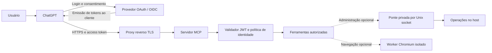

# Personal MCP Server for ChatGPT

## Arquitetura, implementação e procedimento de conexão com OAuth

**Autor:** George Polesel  
**Tipo:** AI Engineering Applied Project  
**Revisão documental:** 03/11/2026  
**Objetivo:** documentar um servidor MCP pessoal, conectado ao ChatGPT, e orientar uma instalação equivalente em outro ambiente.

> Este documento descreve uma implementação existente e contém exemplos adaptados. Os exemplos não foram implantados durante a elaboração do guia. Endereços, identidades e caminhos operacionais foram substituídos por valores genéricos. O arquivo pode ser revisado e colocado em um repositório sem incluir credenciais ou o inventário privado do servidor.

**Descrição curta para portfólio**

Personal MCP server connecting ChatGPT to authenticated operational tools through OAuth, with optional host administration and isolated browser integration.

## Conteúdo

1. [Problema e finalidade](#1-problema-e-finalidade)
2. [Arquitetura e responsabilidades](#2-arquitetura-e-responsabilidades)
3. [Implementação observada](#3-implementação-observada)
4. [Pré-requisitos e decisões](#4-pré-requisitos-e-decisões)
5. [Preparar o provedor OAuth](#5-preparar-o-provedor-oauth)
6. [Implementar o servidor mínimo](#6-implementar-o-servidor-mínimo)
7. [Empacotar e executar](#7-empacotar-e-executar)
8. [Publicar o endpoint HTTPS](#8-publicar-o-endpoint-https)
9. [Verificar descoberta e autenticação](#9-verificar-descoberta-e-autenticação)
10. [Conectar ao ChatGPT](#10-conectar-ao-chatgpt)
11. [Documentar e validar ferramentas](#11-documentar-e-validar-ferramentas)
12. [Adicionar administração opcional](#12-adicionar-administração-opcional)
13. [Adicionar navegador opcional](#13-adicionar-navegador-opcional)
14. [Atualizar ferramentas sem recriar a conexão](#14-atualizar-ferramentas-sem-recriar-a-conexão)
15. [Diagnóstico e operação](#15-diagnóstico-e-operação)
16. [Estrutura para Git e relação com uma skill](#16-estrutura-para-git-e-relação-com-uma-skill)
17. [Evidências e limites desta revisão](#17-evidências-e-limites-desta-revisão)
18. [Referências](#18-referências)

## 1. Problema e finalidade

O projeto foi criado para disponibilizar um servidor próprio ao ChatGPT. Em vez de copiar comandos e resultados entre interfaces, o usuário pode solicitar uma operação e receber a resposta de uma ferramenta executada no ambiente autorizado.

O modelo interpreta o pedido e propõe a chamada. O servidor valida a identidade e executa a função implementada. O retorno da ferramenta fornece a evidência da execução. Essa divisão permite manter integrações e regras no servidor, sem depender de instruções textuais como mecanismo de autorização.

A implantação documentada é pessoal e de alta confiança. Ela demonstra integração operacional com autenticação, mas não é apresentada como plataforma corporativa com segregação de funções, aprovação transacional e autorização granular por operação.

Um servidor MCP não precisa de uma interface gráfica própria. Neste projeto, as funções são acessadas pela conversa. Também não é necessário chamar uma API de LLM dentro do servidor para implementar ferramentas determinísticas.

## 2. Arquitetura e responsabilidades



| Componente | Responsabilidade | Limite |
|---|---|---|
| ChatGPT | Selecionar ferramentas e apresentar resultados ao usuário | Não concede privilégios ao host por si só |
| Provedor OAuth/OIDC | Autenticar o usuário e emitir tokens | Não executa as ferramentas MCP |
| Proxy HTTPS | Encaminhar protocolo, autenticação e metadados | Não deve substituir respostas MCP por uma tela HTML de login |
| Servidor MCP | Anunciar funções, validar acesso e despachar chamadas | Deve rejeitar acesso não autorizado antes da execução |
| Ponte administrativa | Executar operações privilegiadas opcionais | Amplia significativamente o alcance da integração |
| Worker de navegador | Manter sessões e executar ações de navegação opcionais | Não faz parte do servidor mínimo deste guia |

O núcleo é um **resource server OAuth**. O provedor de identidade é o **authorization server**. O ChatGPT atua como cliente OAuth. Essa separação segue o modelo de autorização HTTP do MCP. [1][3]

### 2.1 Fluxo de uma conexão

1. O cliente acessa o endpoint MCP e descobre o provedor de autorização.
2. O usuário conclui o login e o consentimento no provedor.
3. O cliente recebe um access token destinado ao recurso MCP.
4. O servidor verifica assinatura, emissor, audiência, validade e identidade.
5. O cliente inicializa o protocolo, consulta `tools/list` e chama `tools/call`.
6. O servidor devolve o resultado ou um erro verificável.

O transporte deste projeto é **Streamable HTTP**, com modo stateless e respostas JSON. Stateless descreve o transporte MCP; não significa ausência de estado nas ferramentas de navegador ou nos serviços externos. [4]

## 3. Implementação observada

### 3.1 Núcleo técnico

| Item | Estado observado na revisão |
|---|---|
| Sistema | Linux x86_64 |
| Python do contêiner | 3.12.15 |
| SDK `mcp` instalado | 1.30.0 |
| Biblioteca JWT | PyJWT 2.15.1, com suporte criptográfico |
| Cliente HTTP do bridge | httpx 0.28.1 |
| Transporte | FastMCP, `stateless_http=True`, `json_response=True` |
| Provedor de identidade | Keycloak |
| Verificação | RS256, JWKS, `iss`, `aud`, `exp`, `sub` e identidade permitida |
| Processo público | Usuário não root, filesystem somente leitura e capabilities removidas |
| Administração | Serviço separado e privilegiado, acessado por Unix socket |
| Navegador | Worker Chromium/Playwright separado, em rede própria |

O arquivo de dependências existente permite `mcp>=1.12,<2`. A versão efetivamente instalada foi consultada no contêiner. Os exemplos abaixo fixam a linha **1.30.0** para corresponder à API inspecionada. A documentação atual do SDK distingue a linha v1 de manutenção da linha v2. Este guia não descreve uma migração para v2. [5]

### 3.2 Ferramentas acessíveis pela conexão desta revisão

| Ferramenta | Entrada | Finalidade |
|---|---|---|
| `health_check` | Objeto vazio | Saúde lógica e timestamp do serviço |
| `runtime_info` | Objeto vazio | Python, sistema e arquitetura do contêiner |
| `admin_list` | Objeto vazio | Catálogo estático de operações administrativas permitidas pelo dispatcher |
| `admin_call` | `name`, `arguments` opcional | Encaminhamento de uma operação à ponte privada |

`health_check` e `runtime_info` foram executadas com sucesso. `admin_call` também foi usado para inspeções de leitura. Isso demonstra execução pela integração existente, sem substituir uma auditoria completa do cadastro no painel do ChatGPT.

O código do contêiner também contém seis ferramentas `browser_*`, detalhadas na seção 13. Elas não estavam no catálogo oferecido a este chat. Código presente, catálogo habilitado e chamada autenticada são estados diferentes.

### 3.3 Política de identidade existente

O verificador atual restringe um `preferred_username` específico e exige `azp` não vazio. Não há exigência de scopes no `AuthSettings` observado, nem uma matriz de autorização por operação no dispatcher público. Essa política corresponde a uso pessoal com uma identidade confiável.

O exemplo de reprodução da seção 6 é uma adaptação: restringe `sub` e `azp` a valores explicitamente configurados. Isso não foi aplicado ao serviço existente. Em uma implantação com várias pessoas, a autorização deve ser projetada por papel, recurso e operação; um nome de usuário fixo não substitui esse trabalho.

## 4. Pré-requisitos e decisões

Para seguir o procedimento, disponha de:

- Um servidor Linux com Docker e Docker Compose.
- Um domínio HTTPS para o MCP e um provedor OIDC publicado com HTTPS.
- Acesso administrativo autorizado ao provedor e ao proxy.
- Uma conta/workspace do ChatGPT com permissão para cadastrar a conexão.
- Uma identidade de teste e uma lista inicial de ferramentas.

O exemplo pressupõe Keycloak operacional, com banco persistente e configuração de produção. Caso ainda não exista, prepare essa infraestrutura conforme o guia oficial de contêineres antes de criar a conexão. A instalação do provedor não deve usar um ambiente de desenvolvimento descartável como armazenamento definitivo. [8]

Use valores próprios para esta tabela:

| Parâmetro | Exemplo genérico | Onde aparece |
|---|---|---|
| URL canônica do recurso | `https://mcp.example.com/mcp` | Cliente, metadados e validação de audiência |
| Emissor | `https://auth.example.com/realms/personal` | Descoberta OIDC e verificador JWT |
| JWKS | URL informada em `jwks_uri` pelo emissor | Validação de assinatura |
| Sujeito autorizado | `sub` do usuário de teste | Política pessoal do exemplo |
| Cliente OAuth permitido | Client ID do cadastro | Comparação com `azp` no exemplo |
| Redirect URI | Valor mostrado pelo ChatGPT | Allowlist do cliente no provedor |

`client_id`, `azp`, `aud` e `sub` têm funções distintas. `aud` identifica o destino do token; `sub`, o sujeito; `azp`, o cliente autorizado no token Keycloak. Não troque a audiência do MCP pelo Client ID apenas porque ambos aparecem no fluxo.

## 5. Preparar o provedor OAuth

### 5.1 Confirmar a descoberta

No Keycloak, obtenha o documento público:

```text
https://auth.example.com/realms/personal/.well-known/openid-configuration
```

Confirme `issuer`, endpoints de autorização/token e `jwks_uri`. Verifique suporte a Authorization Code, refresh token quando necessário e PKCE `S256`. O servidor MCP valida tokens; não precisa da chave privada de assinatura do Keycloak.

### 5.2 Escolher o cadastro do cliente

A conexão deve usar um mecanismo aceito pelos dois lados: cliente pré-cadastrado, DCR ou CIMD. Não anuncie um mecanismo que o provedor não suporta. Para uma reprodução controlada, o cliente pré-cadastrado facilita conferir ID, autenticação e retorno. [1]

1. Crie um cliente OIDC dedicado e habilite Standard Flow.
2. Configure PKCE com `S256`.
3. Copie do ChatGPT a Redirect URI exata, sem wildcard global.
4. Defina autenticação pública/confidencial conforme a conexão escolhida.
5. Se houver client secret, informe-o somente no campo seguro apropriado.
6. Dê acesso ao usuário autorizado.
7. Habilite os client scopes necessários e a renovação de sessão aplicável.

Não use `client_credentials` para substituir o login delegado do usuário nesta conexão. Não copie callbacks de tutoriais: a URL exibida no cadastro é a referência para aquele cliente.

### 5.3 Incluir a audiência correta

No cliente ou client scope dedicado do Keycloak, configure um mapper **Audience**, com **Included Custom Audience** igual à URL do recurso e **Add to access token** habilitado. Verifique o token do fluxo real sem copiá-lo para logs ou documentos. [7]

Alterar um mapper ou scope compartilhado afeta outros clientes. Para um novo projeto, prefira configuração dedicada. `offline_access` anunciado nos metadados não comprova que um refresh token foi emitido ou renovado com sucesso.

## 6. Implementar o servidor mínimo

O exemplo é intencionalmente limitado a duas ferramentas de leitura. Administração de host e navegador são extensões independentes. Ele acompanha a API v1 inspecionada e não constitui cópia integral da produção.

### 6.1 Dependências diretas

Conteúdo sugerido de `requirements.txt`:

```text
mcp==1.30.0
PyJWT[crypto]==2.15.1
```

`pydantic` é dependência do SDK. Se adicionar o bridge HTTP usado na implantação observada, declare também `httpx` explicitamente, em vez de depender apenas de sua instalação transitiva. Para distribuição reproduzível, gere e revise um lock das dependências completas no ambiente de build.

### 6.2 Configuração sem segredos

Valores ilustrativos para o ambiente do processo:

```dotenv
MCP_ISSUER=https://auth.example.com/realms/personal
MCP_RESOURCE=https://mcp.example.com/mcp
MCP_JWKS_URL=https://auth.example.com/realms/personal/protocol/openid-connect/certs
MCP_ALLOWED_SUBJECT=replace-with-authorized-user-subject
MCP_ALLOWED_CLIENT_ID=replace-with-registered-client-id
```

Esses parâmetros não são access tokens nem client secrets. Mesmo assim, use valores genéricos no arquivo de exemplo e mantenha a configuração real fora do Git. O resource server não precisa receber o client secret para validar JWT por JWKS.

### 6.3 Exemplo completo de `server.py`

```python
import asyncio
import logging
import os
import platform
from datetime import datetime, timezone

import jwt
from jwt import PyJWKClient
from mcp.server.auth.provider import AccessToken, TokenVerifier
from mcp.server.auth.settings import AuthSettings
from mcp.server.fastmcp import FastMCP
from mcp.types import ToolAnnotations
from pydantic import AnyHttpUrl


logging.basicConfig(level=logging.INFO)
logger = logging.getLogger("personal_mcp.auth")

ISSUER = os.environ["MCP_ISSUER"]
RESOURCE = os.environ["MCP_RESOURCE"]
JWKS_URL = os.environ["MCP_JWKS_URL"]
ALLOWED_SUBJECT = os.environ["MCP_ALLOWED_SUBJECT"]
ALLOWED_CLIENT_ID = os.environ["MCP_ALLOWED_CLIENT_ID"]


class PersonalTokenVerifier(TokenVerifier):
    def __init__(self):
        self.jwks = PyJWKClient(JWKS_URL, lifespan=300)

    async def verify_token(self, token: str) -> AccessToken | None:
        try:
            key = await asyncio.to_thread(
                self.jwks.get_signing_key_from_jwt, token
            )
            claims = jwt.decode(
                token,
                key.key,
                algorithms=["RS256"],
                issuer=ISSUER,
                audience=RESOURCE,
                options={"require": ["exp", "iss", "aud", "sub"]},
                leeway=30,
            )

            if claims["sub"] != ALLOWED_SUBJECT:
                return None
            if claims.get("azp") != ALLOWED_CLIENT_ID:
                return None

            scope_text = claims.get("scope", "")
            if not isinstance(scope_text, str):
                return None

            return AccessToken(
                token=token,
                client_id=ALLOWED_CLIENT_ID,
                scopes=scope_text.split(),
                expires_at=claims["exp"],
                subject=claims["sub"],
                resource=RESOURCE,
            )
        except (jwt.PyJWTError, OSError, ValueError) as error:
            logger.warning("token_rejected type=%s", type(error).__name__)
            return None


mcp = FastMCP(
    "Personal MCP Server",
    host="0.0.0.0",
    port=8000,
    stateless_http=True,
    json_response=True,
    token_verifier=PersonalTokenVerifier(),
    auth=AuthSettings(
        issuer_url=AnyHttpUrl(ISSUER),
        resource_server_url=AnyHttpUrl(RESOURCE),
        required_scopes=[],
        validate_token_resource=True,
    ),
)

READ_ONLY = ToolAnnotations(
    readOnlyHint=True,
    destructiveHint=False,
    idempotentHint=True,
    openWorldHint=False,
)


@mcp.tool(annotations=READ_ONLY)
def health_check() -> dict:
    """Return service health without inspecting private application data."""
    return {
        "status": "ok",
        "service": "personal-mcp",
        "timestamp": datetime.now(timezone.utc).isoformat(),
    }


@mcp.tool(annotations=READ_ONLY)
def runtime_info() -> dict:
    """Return Python, operating system and machine architecture only."""
    return {
        "python": platform.python_version(),
        "system": platform.system(),
        "machine": platform.machine(),
    }


if __name__ == "__main__":
    mcp.run(transport="streamable-http")
```

O verificador restringe RS256 e exige as claims essenciais. A biblioteca verifica expiração e valida `nbf` quando presente. Falhas retornam rejeição e registram somente o tipo do erro. O token não é registrado. O campo `resource` do `AccessToken` mantém a associação com a URL já validada. [6][9]

O exemplo não exige um scope específico: sua autorização é pessoal, por sujeito e cliente. Ao introduzir scopes por ferramenta, configure-os no provedor, nos metadados e no servidor, com testes de negação. As anotações `readOnlyHint` ajudam o cliente a classificar funções, mas não substituem controle de acesso.

## 7. Empacotar e executar

Esta seção descreve uma nova instalação. Seus comandos não foram executados para alterar o serviço existente.

### 7.1 Dockerfile de referência

```dockerfile
FROM python:3.12-slim
WORKDIR /app
COPY requirements.txt .
RUN pip install --no-cache-dir -r requirements.txt
COPY server.py .
RUN chmod 0644 /app/server.py
USER 65532:65532
EXPOSE 8000
CMD ["python", "server.py"]
```

A imagem de base é ilustrativa. Para uma release, registre seu digest e valide a resolução de dependências. O exemplo pressupõe saída de rede para obter JWKS do emissor.

### 7.2 Compose de referência

Este exemplo considera Nginx no host e publica a porta somente em loopback. A implantação inspecionada usa proxy em rede Docker e não publica essa porta no host. São topologias alternativas, não duas etapas cumulativas.

```yaml
services:
  personal-mcp:
    build: .
    restart: unless-stopped
    env_file:
      - .runtime.env
    ports:
      - "127.0.0.1:8000:8000"
    read_only: true
    tmpfs:
      - /tmp:rw,noexec,nosuid,size=16m
    cap_drop:
      - ALL
    security_opt:
      - no-new-privileges:true
```

Crie `.runtime.env` localmente a partir dos parâmetros da seção 6.2. Ele deve ser excluído do contexto de build e do versionamento. Não monte `/`, credenciais do host ou `/var/run/docker.sock` para disponibilizar as duas ferramentas de leitura.

No diretório novo e preparado, o operador pode construir e iniciar o componente:

```bash
docker compose config --quiet
docker compose build personal-mcp
docker compose up -d personal-mcp
docker compose ps personal-mcp
```

`config --quiet` valida sem imprimir o ambiente resolvido. Contêiner ativo não prova OAuth nem execução pelo ChatGPT.

## 8. Publicar o endpoint HTTPS

Na topologia de exemplo, o certificado já deve estar instalado e o DNS deve resolver para o proxy. O fragmento a seguir preserva a URI encaminhada, incluindo o caminho de descoberta gerado pelo SDK:

```nginx
server {
    listen 443 ssl;
    server_name mcp.example.com;

    ssl_certificate /etc/letsencrypt/live/mcp.example.com/fullchain.pem;
    ssl_certificate_key /etc/letsencrypt/live/mcp.example.com/privkey.pem;

    location / {
        proxy_pass http://127.0.0.1:8000;
        proxy_http_version 1.1;
        proxy_set_header Host $host;
        proxy_set_header Authorization $http_authorization;
        proxy_set_header X-Forwarded-Proto $scheme;
        proxy_set_header X-Forwarded-For $proxy_add_x_forwarded_for;
        proxy_set_header Connection "";
        proxy_buffering off;
        proxy_read_timeout 120s;
    }
}
```

O Nginx encaminha normalmente os cabeçalhos de resposta necessários; não os oculte com outras regras. A URL canônica configurada no SDK continua sendo a pública. Ajuste limites, confiança nos forwarded headers e validação de Host/Origin à topologia final. [10]

Valide a configuração do proxy antes de uma ativação autorizada. Em um servidor compartilhado, publique apenas o componente afetado. O exemplo não exige reiniciar serviços de outros projetos.

## 9. Verificar descoberta e autenticação

### 9.1 Endpoint protegido

O POST abaixo verifica a rejeição de uma inicialização sem credenciais. Não chama ferramentas:

```bash
curl -i --max-time 15 https://mcp.example.com/mcp \
  -H 'Content-Type: application/json' \
  -H 'Accept: application/json, text/event-stream' \
  --data '{"jsonrpc":"2.0","id":1,"method":"initialize","params":{"protocolVersion":"2025-11-25","capabilities":{},"clientInfo":{"name":"read-check","version":"1.0"}}}'
```

Resultado esperado nessa condição: `401` e um desafio `WWW-Authenticate` com `resource_metadata`. Um GET simples ou um POST de protocolo incompleto pode produzir outro status; isso, isoladamente, não diagnostica indisponibilidade.

### 9.2 Metadados do recurso

Siga a URL exata anunciada no desafio. No SDK/ambiente inspecionado, ela inclui o sufixo `/mcp`:

```text
https://mcp.example.com/.well-known/oauth-protected-resource/mcp
```

Exemplo de conteúdo correspondente ao núcleo pessoal:

```json
{
  "resource": "https://mcp.example.com/mcp",
  "authorization_servers": [
    "https://auth.example.com/realms/personal"
  ],
  "scopes_supported": []
}
```

A raiz `/.well-known/oauth-protected-resource` não respondeu com sucesso na inspeção, enquanto o caminho anunciado respondeu. Esse fato não deve ser “corrigido” apenas para combinar com um exemplo sem caminho. A descoberta deve seguir o desafio válido. [11]

### 9.3 Metadados do emissor

```bash
curl --fail --silent --show-error --max-time 15 \
  https://auth.example.com/realms/personal/.well-known/openid-configuration
```

Compare as URLs com o verificador e o cadastro. A presença de `registration_endpoint` não comprova permissão de registro dinâmico para qualquer cliente. Da mesma forma, suporte anunciado a refresh token não comprova renovação efetiva.

### 9.4 Execução autenticada

Pela conexão OAuth real, use um cliente que conclua a inicialização MCP e então:

1. Consulte `tools/list`.
2. Confirme nomes, entradas e anotações.
3. Execute `health_check`.
4. Execute `runtime_info`.
5. Registre resultado e timestamp sem salvar tokens.

Em uso fora do ChatGPT, o SDK oferece um cliente OAuth de referência. Não substitua o fluxo completo por um JWT inventado. Requisições autenticadas precisam respeitar a versão negociada e os cabeçalhos/sessões do transporte. [6]

## 10. Conectar ao ChatGPT

O caminho atual documentado é **Plugins → adicionar → Add custom MCP server**. Preencha nome, descrição, endpoint HTTPS e autenticação; conclua a revisão de risco e crie o plugin. A interface pode apresentar o fluxo legado de Apps/Scan Tools. As permissões da conta e do workspace continuam aplicáveis. [2]

Procedimento operacional:

1. Procure uma conexão existente para o mesmo servidor antes de cadastrar outra.
2. Use um nome descritivo, como `Personal MCP Server`.
3. Informe a URL completa, incluindo `/mcp`.
4. Selecione OAuth e o mecanismo compatível configurado no provedor.
5. Copie a Redirect URI exibida para a allowlist do cliente OAuth.
6. Informe client secret somente no campo seguro, quando esse mecanismo o exigir.
7. Conclua o login com a identidade permitida pelo verificador.
8. Revise o catálogo e mantenha o público pessoal desejado.
9. Selecione o plugin em uma nova conversa e peça uma chamada de leitura.

Exemplos de pedidos:

```text
Use o Personal MCP Server para consultar health_check.
Depois consulte runtime_info e informe os valores retornados.
```

Registrar uma conexão não torna o servidor público no diretório de plugins. Disponibilizá-lo a um workspace ou ao público exige decisões e procedimentos próprios. Uma conexão existente e funcional não precisa ser recriada para atualizar o catálogo.

## 11. Documentar e validar ferramentas

Cada ferramenta deve ter nome, descrição, esquema de entrada, resposta esperada, efeitos e limites documentados. No servidor mínimo:

| Ferramenta | Obrigatório | Resposta de domínio | Efeito |
|---|---|---|---|
| `health_check` | Nenhum argumento | `status`, `service`, `timestamp` | Nenhuma escrita de negócio |
| `runtime_info` | Nenhum argumento | `python`, `system`, `machine` | Nenhuma escrita de negócio |

Esses campos são o conteúdo de domínio. O SDK pode envolvê-los em `content` e/ou `structuredContent` na resposta MCP. Preserve o envelope real ao documentar contratos de consumidores.

### 11.1 Contrato da extensão administrativa existente

Entrada lógica de `admin_call`, usando apenas uma operação de leitura:

```json
{
  "name": "host_status",
  "arguments": {}
}
```

O dispatcher verifica o nome contra uma allowlist e encaminha `tools/call` à ponte. A resposta inclui `ok` e um `result` ou `error`. O `result` interno ainda pode conter um erro MCP. Um HTTP 200 não deve ser transformado automaticamente em “operação concluída”.

Tratamentos observados no código público:

- Nome não permitido: erro de domínio, sem encaminhamento.
- Falha HTTP ou resposta inválida do bridge: erro de comunicação.
- Erro MCP interno: `ok=false`.
- Timeout de uma operação com efeitos: estado a reconciliar, sem replay automático.

### 11.2 Matriz de validação para uma instalação nova

| Cenário | Resultado a demonstrar | No serviço existente, nesta revisão? |
|---|---|---|
| Inicialização anônima | Rejeição e descoberta utilizável | Sim |
| Saúde pela integração OAuth | Resultado efetivo de `health_check` | Sim |
| Runtime pela integração OAuth | Resultado efetivo de `runtime_info` | Sim |
| Operação administrativa de leitura | Resultado do bridge | Sim |
| Token expirado ou audiência errada | Rejeição antes da ferramenta | Não; validação identificada no código |
| Usuário/cliente não autorizado | Rejeição antes da ferramenta | Não; política identificada no código |
| Renovação após expiração | Continuidade via refresh real | Não |
| `tools/list` autenticado integral | Catálogo efetivo do endpoint | Não |
| Ferramentas de navegador | Resultado e política da sessão | Não |
| Escrita e leitura posterior | Resultado no destino autorizado | Não |

Para testar negações, use emissor/identidades de homologação. Não altere credenciais ou a audiência da conexão principal para provocar erros.

## 12. Adicionar administração opcional

### 12.1 O que existe

A implantação inspecionada separa o MCP público de um serviço administrativo que roda como root. A comunicação usa um Unix socket, sem listener TCP público. O contêiner MCP recebe o diretório do socket e um grupo suplementar autorizado a atravessá-lo.

O bridge disponibiliza operações como status do host, processos, Docker, serviços, arquivos, pacotes e execução de comandos. A allowlist limita os nomes oferecidos, mas uma função que aceita comandos arbitrários como root continua tendo amplo poder. Passar `argv` como lista evita montagem acidental de shell; não cria uma sandbox de comandos.

O serviço administrativo registra ação, horário, hash dos argumentos, sucesso/falha e detalhe limitado. Esse registro não equivale a uma trilha completa de sujeito OAuth, decisão de autorização e aprovação humana por chamada: o wrapper observado não encaminha esse contexto integral ao bridge.

### 12.2 Limites que precisam ficar explícitos

- A exigência de autorização no texto de `admin_call` orienta o agente, mas não implementa um bloqueio transacional no host.
- `required_scopes=[]` e a identidade pessoal não constituem RBAC por operação.
- Um volume de socket montado como `:ro` ainda permite chamadas que alteram o host. A flag protege a montagem, não os efeitos do protocolo servido pelo socket.
- Na inspeção, o diretório tinha modo `0710` com grupo restrito; o socket tinha `0666`. A avaliação deve considerar toda a cadeia de travessia e montagens, não apenas o modo do socket.
- O navegador e outros contêineres não devem receber acesso à ponte por conveniência.

Para uma nova instalação, mantenha a administração ausente até haver necessidade. Se adicionada, defina operações e caminhos permitidos, grupo dedicado, permissão restrita no socket, auditoria de identidade, limites de saída e autorização adequada aos efeitos. Separe operações de leitura das mutáveis quando precisar classificá-las e governá-las de forma diferente.

Este guia não inclui uma implementação copiável de execução arbitrária como root. Documenta a fronteira existente e os requisitos para avaliá-la. Nenhuma permissão, montagem ou operação administrativa foi alterada nesta revisão.

## 13. Adicionar navegador opcional

O código inspecionado contém um worker separado com Chromium e Playwright, acionado por um cliente interno. A revisão identificou:

| Ferramenta | Função descrita no código |
|---|---|
| `browser_open` | Abrir uma página HTTP(S) pública |
| `browser_get_html` | Obter HTML renderizado de uma sessão |
| `browser_extract` | Extrair links, imagens e JSON-LD |
| `browser_click` | Acionar um seletor em uma sessão |
| `browser_download` | Baixar um recurso usando o contexto da sessão |
| `browser_close` | Encerrar a sessão |

O módulo comum verifica URLs e endereços públicos. O worker observado usa usuário não root, filesystem somente leitura, tmpfs e rede própria. Esses controles não foram submetidos a novos testes de segurança nesta revisão.

Sessões, cookies, downloads e cliques exigem política própria. Um clique pode produzir efeitos externos, e uma sessão não deve ser compartilhada entre usuários por inferência. Para ampliar o acesso, verifique vínculo entre sessão e identidade, isolamento de dados, destinos permitidos e proteção contra acesso a redes privadas.

As seis funções estavam presentes no arquivo do contêiner, cujo hash correspondia ao arquivo inspecionado no servidor. Isso não comprova sincronização no ChatGPT nem execução dessas funções por esta conexão. Não copie sua disponibilidade para a descrição do plugin antes de conferir o catálogo e os testes correspondentes.

## 14. Atualizar ferramentas sem recriar a conexão

Após uma alteração autorizada de nome, descrição, esquema ou anotações:

1. Valide o código e publique apenas o serviço MCP afetado.
2. Confirme a versão realmente em execução.
3. Consulte o catálogo autenticado do servidor.
4. Abra a conexão existente no ChatGPT e use **Refresh/Atualizar ferramentas**.
5. Confira os nomes e estados habilitados.
6. Inicie uma nova conversa com o plugin selecionado e teste as funções afetadas.

Esse fluxo corresponde à conexão MCP personalizada direta. Publicações distribuídas podem ter outro processo de revisão. A atualização do painel não prova que um chat já aberto recebeu o novo catálogo. [12]

| Camada | Pergunta |
|---|---|
| Arquivo no servidor | O código novo existe? |
| Processo/contêiner | O código novo está carregado? |
| `tools/list` autenticado | O endpoint anuncia a ferramenta? |
| Cadastro do ChatGPT | A ação está sincronizada e habilitada? |
| Catálogo da conversa | O agente consegue chamá-la neste turno? |
| Execução | A chamada retornou um resultado verificável? |

Se a diferença estiver no catálogo da conversa, não reinstale Keycloak nem revogue uma conexão OAuth saudável. A atualização de uma lista de ferramentas não exige ampliar o público do plugin ou selecionar “permitir tudo”.

## 15. Diagnóstico e operação

### 15.1 Diagnóstico por sintoma

| Sintoma | Verificar primeiro | Evitar |
|---|---|---|
| 401 sem descoberta utilizável | Desafio e rota de metadados no proxy/SDK | Desabilitar autenticação |
| Login conclui, ferramenta é recusada | `iss`, `aud`, validade, identidade e cliente do token real | Confiar apenas em token simulado |
| `invalid_client` | Cadastro e método de autenticação do cliente | Criar clientes repetidamente por tentativa |
| Erro de Redirect URI | Valor exato exibido pelo ChatGPT | Wildcard global |
| Falha após algum tempo | Refresh efetivo e políticas de sessão | Tratar anúncio de suporte como teste de renovação |
| Servidor anuncia mais ferramentas que o painel | Atualização no cadastro existente | Reescrever a implementação correta |
| Painel tem ferramenta, conversa não | Nova conversa/plugin selecionado | Fazer chamadas a funções indisponíveis |
| Saúde funciona, administração falha | Socket, grupo, serviço e envelope de erro | Expor a ponte por TCP |
| Requisição retorna HTML | Proxy, redirecionamento e middleware de login | Interpretar a página como resposta MCP |
| Resultado de mutação é incerto | Estado do destino e evidência do provedor | Reexecutar automaticamente |

### 15.2 Rotina de manutenção

Versione contratos e mudanças. Antes de uma release, registre imagem, dependências, configuração não sensível e catálogo esperado. Faça testes de leitura e de negação em homologação. Uma mudança de descrição também pode alterar a escolha da ferramenta pelo modelo.

Preserve logs sem tokens, cookies, client secrets ou conteúdo privado desnecessário. Dados retornados por ferramentas e páginas externas não podem redefinir autorização. Falha de rede, erro MCP e erro de negócio devem continuar distinguíveis.

Quando uma correção de transporte ou descoberta for necessária, preserve cadastro, identidade e sessões que funcionam. Não use um restart global de serviços compartilhados como etapa padrão de diagnóstico.

## 16. Estrutura para Git e relação com uma skill

### 16.1 Organização sugerida

```text
personal-mcp-server/
├── README.md
├── server.py
├── requirements.txt
├── Dockerfile
├── compose.yaml
├── .env.example
├── .gitignore
├── .dockerignore
├── docs/
│   └── MCP_Server_ChatGPT_Guia_Tecnico.md
└── tests/
    ├── test_auth.py
    └── test_tools.py
```

Essa árvore é uma proposta de organização, não uma afirmação de que todos esses arquivos estejam disponíveis no repositório documental. Os exemplos são apresentados neste guia; o código da implantação permanece separado.

Exclusões sugeridas tanto para `.gitignore` quanto para `.dockerignore`, ajustando o contexto do build:

```gitignore
.env
.env.*
!.env.example
.runtime.env
.runtime/
.secrets/
.venv/
__pycache__/
*.pem
*.key
*.p12
*.pfx
*.log
downloads/
backups/
```

O filtro do Git não evita que um arquivo seja enviado ao contexto Docker. Por isso há dois controles. Revise também arquivos já versionados, exemplos, backups e capturas de tela. Não escolha uma licença de distribuição para todo o projeto sem verificar os direitos sobre seus componentes; a licença do SDK não decide automaticamente a licença da aplicação.

### 16.2 O que mostrar no repositório

Um repositório útil demonstra arquitetura, contrato, implementação mínima, configuração por exemplos, evidência de testes e limites. O conteúdo do servidor real, seus segredos e inventário administrativo não são necessários para essa demonstração.

A descrição pública deve informar a finalidade pessoal e o mecanismo de acesso, sem alegar certificação, isolamento corporativo ou políticas que não estejam implementadas. Para um README curto, use a descrição de portfólio no início deste guia e mantenha o procedimento detalhado em `docs/`.

### 16.3 MCP, skill e PDF

| Artefato | Papel |
|---|---|
| Servidor MCP | Implementação executável das ferramentas e sua autorização |
| Repositório Git | Código, contratos, exemplos e histórico de revisão |
| Skill | Instruções para descobrir, conectar, usar e diagnosticar a integração |
| PDF de projeto | Visão resumida para portfólio ou apresentação |

Uma skill não cria acesso administrativo, não armazena credenciais e não substitui o servidor. Pode orientar o agente a descobrir metadados, preservar a conexão, chamar ferramentas de leitura e distinguir sincronização de execução.

A publicação da documentação não cria uma nova skill, não concede acesso ao servidor e não publica seus endpoints privados. Um repositório de documentação pode conter este guia e uma apresentação do projeto sem distribuir o código operacional.

## 17. Evidências e limites desta revisão

### 17.1 Verificações realizadas em 03/11/2026

- Leitura do código MCP, definições de build e configuração estrutural dos contêineres.
- Consulta das versões instaladas no contêiner, sem atualizar dependências.
- Comparação de hash de `server.py` no servidor e no contêiner: correspondentes.
- Leitura dos metadados públicos do recurso no caminho indicado pelo desafio.
- Leitura dos metadados OIDC do provedor e identificação de suporte a PKCE `S256`.
- Inicialização anônima rejeitada com 401 e `resource_metadata` utilizável.
- Execução de `health_check` e `runtime_info` pela conexão existente.
- Uso do bridge para inspeções de leitura, incluindo estado do serviço e permissões do socket.
- Consulta de documentação oficial para a API v1 e o cadastro atual no ChatGPT.

### 17.2 O que não foi demonstrado por essa inspeção

Não foram refeitos login/consentimento no navegador, renovação de tokens, testes negativos com tokens controlados, auditoria completa de todas as operações administrativas, testes do navegador ou uma instalação nova de ponta a ponta. O método de registro OAuth usado pelo cadastro existente não foi reconfirmado no painel.

Os trechos de reprodução são adaptados para documentação. A validação de sintaxe e compatibilidade indicada na entrega não deve ser confundida com implantação, emissão real de tokens ou testes funcionais completos desses exemplos.

### 17.3 Validação dos exemplos do documento

O trecho Python foi instanciado em um processo separado com as bibliotecas da implantação inspecionada, configuração fictícia e assinatura RSA temporária. A obtenção de JWKS foi substituída por uma chave pública sintética em memória. Não houve chamada ao emissor, abertura de listener, implantação ou gravação persistente desse exemplo.

Oito verificações passaram: token válido, audiência incorreta, expiração, sujeito incorreto, cliente incorreto, tipo inválido de scopes, registro das duas ferramentas com anotação de leitura e chamada direta das duas funções. São verificações do exemplo documental, não testes negativos contra o serviço público.

Também foram conferidos sintaxe Python, objetos JSON, estrutura YAML, fechamento dos blocos de código e ausência dos identificadores privados pesquisados no texto final. O Compose e o fragmento Nginx não foram implantados. A configuração de Keycloak e o fluxo de navegador precisam ser validados no ambiente de destino.

## 18. Referências

Documentação consultada em 03/11/2026. Interfaces e versões podem evoluir; preserve a linha do SDK ao reproduzir o exemplo e revise os controles apresentados pela conta.

1. [OpenAI — Authentication](https://developers.openai.com/plugins/build/auth): conexão entre recurso, provedor e cliente OAuth.
2. [OpenAI — Connecting custom MCP servers in ChatGPT](https://help.openai.com/en/articles/12584461-connecting-custom-mcp-servers-in-chatgpt): cadastro e permissões na interface atual.
3. [MCP — Authorization, revisão 2025-11-25](https://modelcontextprotocol.io/specification/2025-11-25/basic/authorization): modelo de autorização e vinculação de tokens ao recurso.
4. [MCP — Transports, revisão 2025-11-25](https://modelcontextprotocol.io/specification/2025-11-25/basic/transports): transporte Streamable HTTP.
5. [MCP Python SDK v1](https://py.sdk.modelcontextprotocol.io/v1/): documentação da linha usada no ambiente inspecionado.
6. [MCP Python SDK v1 — Authorization](https://py.sdk.modelcontextprotocol.io/v1/authorization/): `TokenVerifier`, `AccessToken` e `AuthSettings`.
7. [Keycloak — Server Administration Guide](https://www.keycloak.org/docs/latest/server_admin/): clientes OIDC, scopes e mappers de audiência.
8. [Keycloak — Running Keycloak in a container](https://www.keycloak.org/server/containers): preparação do provedor em contêiner.
9. [PyJWT — Usage](https://pyjwt.readthedocs.io/en/stable/usage.html): validação de JWT e obtenção de chaves públicas.
10. [Nginx — HTTP proxy module](https://nginx.org/en/docs/http/ngx_http_proxy_module.html): encaminhamento HTTP pelo proxy.
11. [RFC 9728 — OAuth 2.0 Protected Resource Metadata](https://www.rfc-editor.org/rfc/rfc9728.html): descoberta dos metadados de um recurso protegido.
12. [OpenAI — Connect and test your plugin](https://developers.openai.com/plugins/deploy/connect-chatgpt): atualização de metadados e verificação pela conversa.

---

**Escopo:** documentação técnica e procedimento de reprodução, acompanhados de uma apresentação resumida do projeto. A publicação destes materiais não modifica código da implantação, credenciais, serviços ou o cadastro da conexão.
